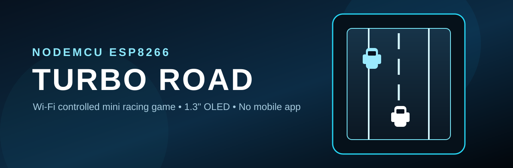
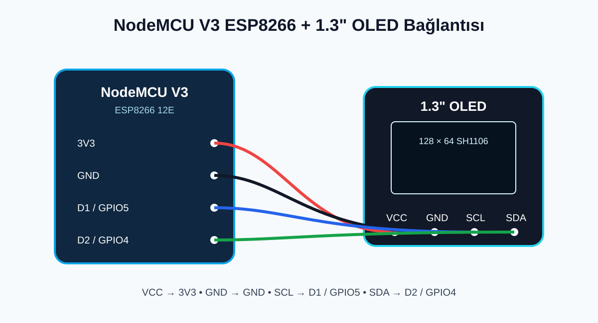
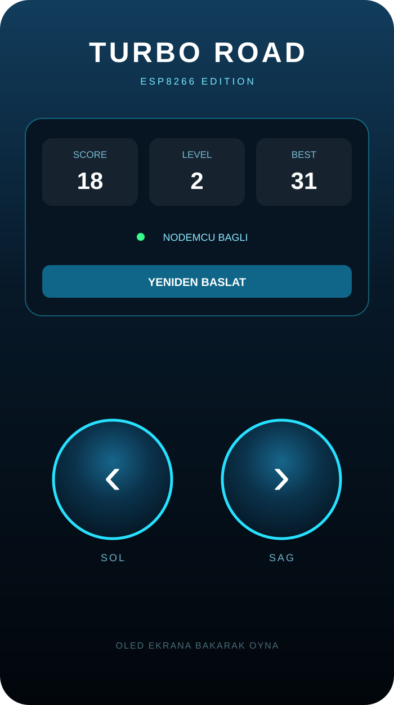

# ESP8266 Turbo Road



**ESP8266 Turbo Road**, NodeMCU V3 ESP8266 ve 1.3" SH1106 OLED ekran üzerinde çalışan, telefondaki yerel web arayüzünden kontrol edilen mini bir araba oyunudur.

ESP8266 kendi Wi‑Fi ağını oluşturur. Telefonda herhangi bir uygulama yüklemeden `192.168.4.1` adresine girerek oyunu kontrol edebilirsiniz.

## Özellikler

- NodeMCU V3 ESP8266 üzerinde çalışır
- 1.3" 128×64 SH1106 I2C OLED desteği
- Telefonda responsive web kumandası
- 3 şeritli trafik sistemi
- Yumuşak şerit değiştirme animasyonu
- Skor, seviye ve en iyi skor göstergesi
- Oyun ilerledikçe kademeli hızlanma
- 3 farklı rakip araç çizimi
- Harici sunucu veya internet bağlantısı gerektirmez
- Ses yok; sadece ESP8266 + OLED ile çalışır

## Proje Görselleri

### Bağlantı şeması



### Telefon kumandası



## Gerekli Malzemeler

| Parça | Adet |
|---|---:|
| NodeMCU V3 ESP8266 12E | 1 |
| 1.3" 128×64 I2C OLED (SH1106) | 1 |
| Jumper kablo | 4 |
| USB veri kablosu | 1 |

## Bağlantılar

| OLED | NodeMCU V3 |
|---|---|
| GND | GND |
| VCC | 3V3 |
| SCL | D1 / GPIO5 |
| SDA | D2 / GPIO4 |

> OLED modülünüzün pin sırasına değil, kart üzerindeki `GND`, `VCC`, `SCL`, `SDA` etiketlerine göre bağlantı yapın.

## Arduino IDE Kurulumu

### 1. ESP8266 kart paketini kurun

Arduino IDE → **Dosya → Tercihler → Ek Kart Yöneticisi URL'leri**

```text
https://arduino.esp8266.com/stable/package_esp8266com_index.json
```

Daha sonra:

**Araçlar → Kart → Kart Yöneticisi**

`esp8266` aratın ve **esp8266 by ESP8266 Community** paketini kurun.

### 2. Doğru kartı seçin

```text
Araçlar
→ Kart
→ ESP8266 Boards
→ NodeMCU 1.0 (ESP-12E Module)
```

### 3. Kütüphaneleri kurun

Arduino IDE Kütüphane Yöneticisi'nden:

- `Adafruit GFX Library`
- `Adafruit SH110X`

kütüphanelerini kurun.

## Kodu Yükleme

Arduino IDE'de şu dosyayı açın:

```text
TurboRoad_ESP8266/TurboRoad_ESP8266.ino
```

NodeMCU'nun COM portunu seçin ve **Yükle** butonuna basın.

## Oyunu Başlatma

Kod yüklendikten sonra ESP8266 şu Wi‑Fi ağını oluşturur:

```text
WiFi: TURBO-ROAD
Şifre: 12345678
```

Telefonunuzdan bu ağa bağlanın.

Telefon, **"Bu ağda internet yok"** uyarısı gösterebilir. Bu normaldir; bağlantıyı koruyun.

Tarayıcıdan:

```text
http://192.168.4.1
```

adresini açın.

Telefon ekranındaki **SOL** ve **SAĞ** butonlarıyla OLED üzerindeki aracı kontrol edin.

## Oyun Mantığı

- Oyuncu 3 şerit arasında hareket eder.
- Rakip araçlar ekranın üstünden aşağı gelir.
- Her kaçırılan araç skor kazandırır.
- Skor arttıkça trafik kademeli olarak hızlanır.
- Çarpışma olduğunda `GAME OVER` ekranı açılır.
- Telefon arayüzündeki **YENİDEN BAŞLAT** düğmesiyle yeni oyun başlatılır.

## Varsayılan Ayarlar

```cpp
const char* AP_NAME = "TURBO-ROAD";
const char* AP_PASSWORD = "12345678";

#define OLED_ADDRESS 0x3C
#define OLED_SDA D2
#define OLED_SCL D1
```

OLED görüntü vermiyorsa bazı modüllerde I2C adresi `0x3D` olabilir.

## Klasör Yapısı

```text
esp8266-turbo-road/
├── .github/
│   └── workflows/
│       └── compile.yml
├── TurboRoad_ESP8266/
│   └── TurboRoad_ESP8266.ino
├── assets/
│   └── banner.svg
├── docs/
│   ├── controller-preview.svg
│   ├── wiring.svg
│   └── SETUP_TR.md
├── .gitignore
├── CHANGELOG.md
├── CONTRIBUTING.md
├── LICENSE
└── README.md
```

## Teknik Bilgiler

- MCU: ESP8266EX
- Geliştirme kartı: NodeMCU V3 / ESP-12E
- Ekran: SH1106 128×64 OLED
- Haberleşme: I2C
- Kontrol: ESP8266 SoftAP + HTTP
- Varsayılan IP: `192.168.4.1`
- Web sunucusu: `ESP8266WebServer`
- Ekran kütüphanesi: `Adafruit_SH110X`

## Lisans

Bu proje [MIT Lisansı](LICENSE) ile yayınlanmıştır.

---

### English

A compact Wi‑Fi controlled racing game for **NodeMCU ESP8266 + 1.3" SH1106 OLED**. The ESP8266 creates its own access point and hosts a mobile-friendly controller at `192.168.4.1`. No external server or mobile app is required.
